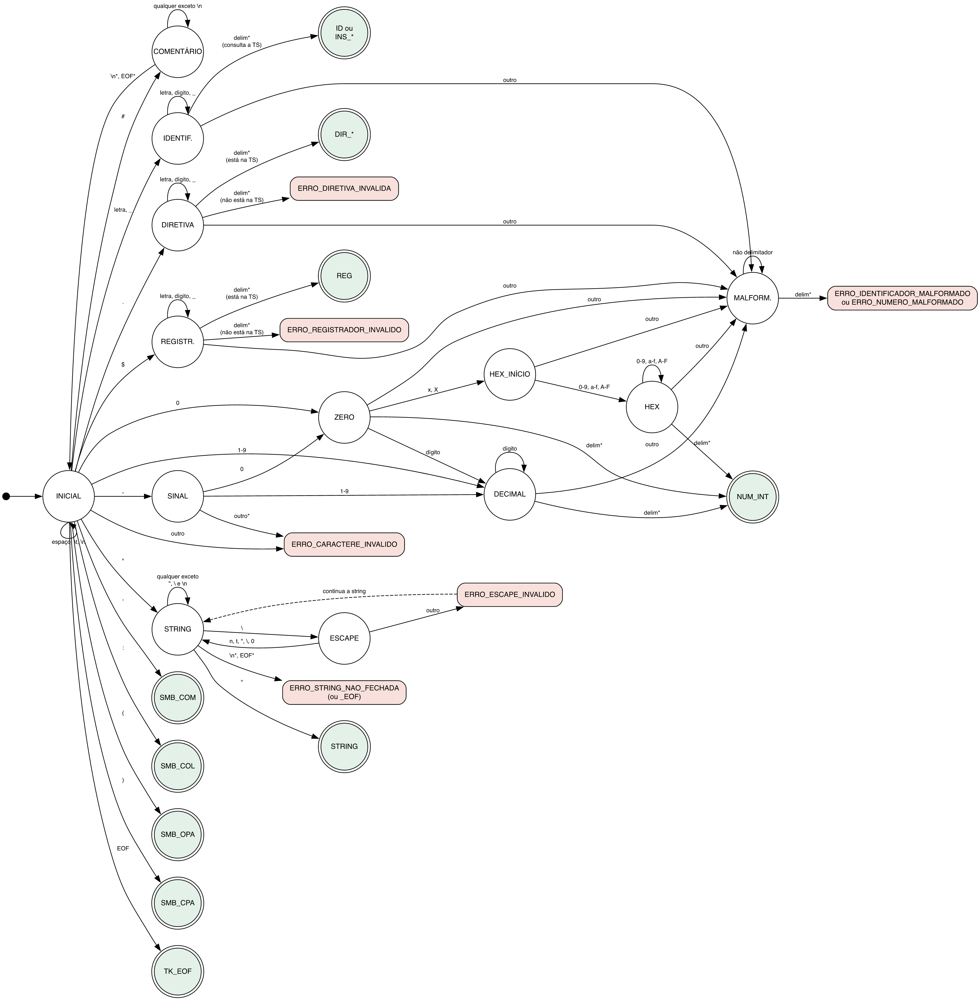

# Relatório técnico: analisador léxico μ-Assembly

Universidade Católica de Brasília  
Linguagens Formais, Autômatos e Compiladores - Professor Marcelo Eustáquio

Grupo: Breno Marques, Thiago de Jesus, Roberty Luann e Arthur

## 1. Visão geral

O programa recebe um arquivo `.asm` escrito em μ-Assembly e executa duas
etapas em sequência. A primeira é o pré-processamento, que normaliza o
código-fonte removendo comentários, linhas vazias e espaços desnecessários. A
segunda é a análise léxica, que lê o código normalizado, agrupa os caracteres
em lexemas e classifica cada um deles.

São gerados quatro arquivos: o código normalizado (`.pre`), os tokens
reconhecidos (`.lex`), a tabela de símbolos (`.ts`) e os erros léxicos
encontrados (`.err`).

O código está dividido em cinco arquivos, como pede o enunciado:

| Arquivo                   | Conteúdo                                                           |
| ------------------------- | ------------------------------------------------------------------ |
| `main.c`                  | Validação dos argumentos, abertura dos arquivos e ordem das etapas |
| `preprocessador.c` / `.h` | Etapa 1                                                            |
| `lexico.c` / `.h`         | Etapa 2                                                            |

A compilação e a execução seguem o formato do enunciado:

```
gcc main.c preprocessador.c lexico.c -o main.exe
main.exe teste.asm teste.lex
```

(Na etapa 3 essa chamada mudou: o segundo argumento passou a ser um prefixo.
Veja o relatório daquela etapa.)

A função `main()` valida os argumentos, abre os arquivos e chama
`PreProcessamento(in, out)` e, em seguida, `AnaliseLexica(in, out)`.

## 2. Estruturas de dados

### Token

É a estrutura definida no enunciado. O campo `nome` guarda a categoria do
token, como `INS_ADD`, `REG` ou `ID`.

```c
typedef struct {
    char nome[50];
    char lexema[100];
    int linha;
    int coluna;
} Token;
```

A mesma estrutura é usada para guardar os erros léxicos, porque o formato de
um erro no `.err` é igual ao de um token no `.lex`: muda apenas o conteúdo do
campo `nome`, que passa a ser o tipo do erro. Isso evita criar uma segunda
estrutura praticamente idêntica.

### Simbolo

Cada entrada da tabela de símbolos:

```c
typedef struct {
    char lexema[100];
    char categoria[30];
    int primeiraLinha;
    int primeiraColuna;
} Simbolo;
```

### Vetores de palavras reservadas

Três vetores constantes guardam os lexemas fixos da linguagem: `DIRETIVAS`
(10 itens), `INSTRUCOES` (36 itens) e `REGISTRADORES` (31 nomes). As formas
numéricas `$0` a `$31` são geradas por um laço durante a carga da tabela.
Para acrescentar uma instrução ao subconjunto, basta incluir o nome no vetor:
o reconhecimento e o nome do token são derivados automaticamente.

### Estado do módulo

O analisador mantém em `lexico.c` um conjunto de variáveis `static`, visíveis
apenas dentro do arquivo:

- `entrada`, `linha` e `coluna`: o arquivo em leitura e a posição atual;
- `tabela`, `total_simbolos` e `capacidade_tabela`: a tabela de símbolos;
- `erros`, `total_erros` e `capacidade_erros`: a lista de erros.

Esse estado precisa sobreviver entre chamadas porque `ProximoToken()` é
chamada repetidamente e cada chamada continua de onde a anterior parou.

A tabela de símbolos e a lista de erros são vetores alocados com `malloc` que
dobram de tamanho com `realloc` quando enchem, começando com 128 e 32
posições. Não há, portanto, um limite fixo para a quantidade de símbolos ou
de erros. A busca na tabela é sequencial, o que é adequado para a ordem de
grandeza dos programas usados no trabalho (pouco mais de cem entradas).

## 3. Funções implementadas

### `lexico.c`

| Função                               | Descrição                                                                        |
| ------------------------------------ | -------------------------------------------------------------------------------- |
| `IniciarLexico(FILE *in)`            | Zera a posição de leitura e carrega as palavras reservadas na tabela de símbolos |
| `ProximoToken(void)`                 | Implementa o AFD e devolve o próximo token do arquivo                            |
| `AnaliseLexica(FILE *in, FILE *out)` | Chama `ProximoToken()` até o `TK_EOF`, gravando cada token em `out`              |
| `GravarTabelaSimbolos(FILE *ts)`     | Grava a tabela em formato CSV e devolve a quantidade de símbolos                 |
| `GravarErros(FILE *err)`             | Grava os erros e devolve a quantidade encontrada                                 |
| `LiberarLexico(void)`                | Libera a memória da tabela e da lista de erros                                   |
| `espiar()`                           | Lê o próximo caractere sem retirá-lo do arquivo                                  |
| `avancar()`                          | Consome o caractere e atualiza linha e coluna                                    |
| `consumir()`                         | Avança e acrescenta o caractere ao lexema em formação                            |
| `eh_letra()`, `eh_char_id()`         | Classes de caracteres dos identificadores                                        |
| `eh_delimitador()`                   | Indica se um caractere encerra o lexema                                          |
| `para_minusculas()`                  | Converte um lexema para minúsculas                                               |
| `montar_nome()`                      | Monta nomes como `INS_ADD` e `DIR_ASCIIZ`                                        |
| `buscar_simbolo()`                   | Procura um lexema na tabela                                                      |
| `inserir_simbolo()`                  | Insere um símbolo, sem repetir lexemas                                           |
| `reconhecer_reservada()`             | Consulta uma diretiva, instrução ou registrador e marca o primeiro uso           |
| `classificar_palavra()`              | Decide entre instrução e identificador                                           |
| `registrar_erro()`                   | Acrescenta um erro à lista                                                       |
| `erro_de_numero()`                   | Escolhe o tipo de erro de um número malformado                                   |
| `sem_memoria()`                      | Encerra o programa quando uma alocação falha                                     |

As funções públicas usam PascalCase, seguindo a `AnaliseLexica()` definida no
enunciado; as auxiliares internas são `static` e usam minúsculas com `_`.

### `preprocessador.c`

| Função                                  | Descrição                                                                 |
| --------------------------------------- | ------------------------------------------------------------------------- |
| `PreProcessamento(FILE *in, FILE *out)` | Percorre o arquivo e grava a versão normalizada                           |
| `ler_linha()`                           | Lê uma linha aceitando `\n`, `\r\n` e `\r`, com buffer que cresce sozinho |
| `processar_linha()`                     | Aplica as etapas de limpeza a uma linha                                   |
| `remover_comentario()`                  | Corta a linha no primeiro `#` fora de uma string                          |
| `normalizar_espacos()`                  | Normaliza brancos fora das aspas                                          |
| `linha_vazia()`, `eh_espaco()`          | Apoio às funções acima                                                    |
| `mensagem_erro()`                       | Traduz um código de erro para texto                                       |

### `main.c`

| Função                            | Descrição                                                          |
| --------------------------------- | ------------------------------------------------------------------ |
| `main()`                          | Valida argumentos, monta os nomes dos arquivos e executa as etapas |
| `trocar_extensao()`               | Deriva os nomes do `.pre`, `.ts` e `.err` a partir do `.lex`       |
| `nomes_repetidos()`               | Impede que dois dos arquivos tenham o mesmo nome                   |
| `executar_preprocessamento()`     | Abre os arquivos da etapa 1 e trata os erros                       |
| `executar_analise_lexica()`       | Abre os arquivos da etapa 2 e trata os erros                       |
| `abrir_saida()`, `fechar_saida()` | Abertura e fechamento conferindo falhas de gravação                |
| `exibir_uso()`                    | Mostra o formato da linha de comando                               |

## 4. O autômato finito determinístico

O reconhecimento é feito por um AFD implementado em `ProximoToken()`. O
`enum Estado` lista os estados e o `switch` dentro do laço possui um `case`
para cada um, contendo as transições que saem dele. O diagrama a seguir foi
elaborado com Graphviz e está em `docs/afd.dot`.



Cada volta do laço faz sempre a mesma coisa: espia o próximo caractere e o
estado atual decide se o consome e permanece, se o consome e muda de estado,
ou se o lexema terminou.

| Estado            | Chega-se nele lendo                    | Função                                                    |
| ----------------- | -------------------------------------- | --------------------------------------------------------- |
| `E_INICIAL`       | (nenhum)                               | Ignora brancos e decide pelo primeiro caractere do lexema |
| `E_COMENTARIO`    | `#`                                    | Consome até o fim da linha, sem gerar token               |
| `E_IDENTIFICADOR` | letra ou `_`                           | Acumula letras, dígitos e `_`                             |
| `E_DIRETIVA`      | `.`                                    | Acumula e compara com as diretivas                        |
| `E_REGISTRADOR`   | `$`                                    | Acumula e compara com os registradores                    |
| `E_SINAL`         | `-`                                    | Só forma número se o próximo caractere for dígito         |
| `E_ZERO`          | `0`                                    | Separa o zero, o decimal e o hexadecimal                  |
| `E_DECIMAL`       | `1` a `9`                              | Acumula dígitos                                           |
| `E_HEX_INICIO`    | `0x`                                   | Exige ao menos um dígito hexadecimal                      |
| `E_HEX`           | dígito hexadecimal                     | Acumula dígitos hexadecimais                              |
| `E_STRING`        | `"`                                    | Acumula até as aspas de fechamento                        |
| `E_ESCAPE`        | `\` dentro da string                   | Valida a sequência de escape                              |
| `E_MALFORMADO`    | caractere inválido dentro de um lexema | Descarta até o próximo delimitador                        |

Os símbolos `,` `:` `(` `)` não possuem estado próprio, pois têm um único
caractere: o estado inicial já devolve o token correspondente.

### Delimitadores e a leitura por antecipação

Um lexema termina quando aparece um delimitador: espaço, tabulação, quebra de
linha, vírgula, dois-pontos, parênteses, aspas, `#` ou o fim do arquivo. O
estado percebe o fim do lexema mas não consome o delimitador, que fica
disponível para a próxima chamada. No diagrama isso aparece como `delim*`.

Essa decisão é o que permite reconhecer construções como `4($sp)`. O
parêntese encerra o número `4` e, na chamada seguinte, é reconhecido como
`SMB_OPA`. Se o estado do número consumisse o parêntese, esse token seria
perdido.

Para implementar a antecipação usamos duas funções: `espiar()`, que lê um
caractere e o devolve ao arquivo com `ungetc()`, e `avancar()`, que consome de
fato. Com isso nenhum estado precisa desfazer leituras.

## 5. Controle de linha e coluna

O controle é centralizado em `avancar()`, a única função que altera as
variáveis `linha` e `coluna`. A regra é simples: uma quebra de linha soma uma
linha e devolve a coluna para 1; qualquer outro caractere soma uma coluna.
Como nenhuma outra parte do código toca nessas variáveis, não há risco de a
contagem ficar correta em um ponto e incorreta em outro.

A posição registrada em um token é a do seu primeiro caractere. O estado
inicial guarda `linha` e `coluna` antes de consumir qualquer coisa, e são
esses valores que vão para o token. O mesmo vale para os erros.

O `TK_EOF` recebe a posição do fim do arquivo. Em um arquivo com quatro
linhas terminadas por quebra de linha, ele é registrado como linha 5, coluna 1.

Uma observação importante: as posições se referem ao arquivo `.pre`, que é o
arquivo lido pela análise léxica conforme o enunciado. Como o
pré-processamento remove a indentação e as linhas em branco, essas posições
podem diferir das do `.asm` original. O item 11 deste relatório detalha o
ponto.

## 6. Tratamento e recuperação de erros

São detectados oito tipos de erro:

| Tipo                            | Exemplo                                   |
| ------------------------------- | ----------------------------------------- |
| `ERRO_CARACTERE_INVALIDO`       | `@`, ou um `-` que não antecede um número |
| `ERRO_IDENTIFICADOR_MALFORMADO` | `2valor`, `soma-total`, `inicio@`         |
| `ERRO_NUMERO_MALFORMADO`        | `0xG1`, `0x`, `12.5`                      |
| `ERRO_DIRETIVA_INVALIDA`        | `.dados`                                  |
| `ERRO_REGISTRADOR_INVALIDO`     | `$t10`, `$32`, `$x1`                      |
| `ERRO_STRING_NAO_FECHADA`       | cadeia sem aspas até a quebra de linha    |
| `ERRO_STRING_NAO_FECHADA_EOF`   | cadeia sem aspas até o fim do arquivo     |
| `ERRO_ESCAPE_INVALIDO`          | `\q` dentro de uma cadeia                 |

Para cada erro são registrados o tipo, o lexema ou caractere relacionado, a
linha e a coluna.

### Estratégia de recuperação

Um lexema com erro não gera token. O erro é guardado na lista e o autômato
volta ao estado inicial para procurar o próximo lexema. Dessa forma
`ProximoToken()` devolve apenas tokens válidos, o `.lex` permanece limpo para
a análise sintática e o `.err` reúne todos os erros do arquivo, e não somente
o primeiro.

A forma de recuperar depende de onde o erro aparece:

- **Caractere inválido iniciando um lexema** (`@`): registra apenas aquele
  caractere e segue a partir do seguinte.
- **Caractere inválido dentro de um lexema** (`inicio@`, `0xG1`): o autômato
  vai para `E_MALFORMADO`, que descarta os caracteres até o próximo
  delimitador e registra o lexema inteiro. Sem isso, `inicio@` produziria um
  `ID` aparentemente válido seguido de um erro isolado, escondendo o problema.
- **Lexema bem formado, porém desconhecido** (`.dados`, `$t10`): a forma está
  correta, mas o lexema não consta na tabela de símbolos. O erro é registrado
  no momento da consulta.
- **Cadeia não fechada**: registra o que foi lido até a quebra de linha, sem
  consumi-la, de modo que a linha seguinte é analisada normalmente.
- **Escape inválido**: registra o erro na posição da contrabarra e continua
  lendo a cadeia até as aspas de fechamento, para não interpretar o restante
  do texto como código. A cadeia não produz token.

### Exemplo

Para o arquivo `testes/lexico/erro_1.asm`, cujo código normalizado é

```
1  .text
2  main:
3  li $t0, 10
4  add $t1, $t0, @
5  li $t10, 5
6  move $32, $x1
7  li $v0, 10
8  syscall
```

o `.err` contém

```
<ERRO_CARACTERE_INVALIDO, @> 4 15
<ERRO_REGISTRADOR_INVALIDO, $t10> 5 4
<ERRO_REGISTRADOR_INVALIDO, $32> 6 6
<ERRO_REGISTRADOR_INVALIDO, $x1> 6 11
```

e o `.lex` segue registrando os tokens válidos das mesmas linhas, o que
demonstra a recuperação:

```
<INS_ADD, add> 4 1
<REG, $t1> 4 5
<SMB_COM, ,> 4 8
<REG, $t0> 4 10
<SMB_COM, ,> 4 13
<INS_LI, li> 5 1
<SMB_COM, ,> 5 8
<NUM_INT, 5> 5 10
```

Na linha 4 os quatro tokens anteriores ao `@` foram reconhecidos e a análise
prosseguiu na linha 5. Na linha 5, o lexema `$t10` gerou erro, mas a vírgula e
o número 5 continuaram sendo reconhecidos.

### Erros de execução

Além dos erros léxicos, o programa trata as falhas de execução. Se a
quantidade de argumentos estiver incorreta, se algum arquivo não puder ser
aberto ou se dois arquivos receberem o mesmo nome, é exibida uma mensagem
clara e a execução é encerrada. As falhas de leitura e de gravação são
verificadas com `ferror()` e no retorno de `fclose()`; nesses casos o arquivo
incompleto é removido, para que nenhuma etapa seguinte receba uma saída
truncada.

## 7. Tabela de símbolos

### Carga inicial

`IniciarLexico()` insere, com linha e coluna iguais a zero, as 10 diretivas,
as 36 instruções, os 31 registradores nomeados e os 32 registradores
numéricos `$0` a `$31`. São 109 entradas antes da leitura do primeiro
caractere. A posição é preenchida quando o símbolo aparece pela primeira vez
no programa.

### Palavras reservadas

O enunciado determina que o analisador consulte a tabela para decidir se um
lexema formado por letras é instrução ou identificador, e é o que
`reconhecer_reservada()` faz: converte o lexema para minúsculas, procura na
tabela e confere a categoria.

Como a busca é feita em minúsculas, `ADD`, `Add` e `add` são a mesma
instrução. O `.lex` registra o lexema como ele aparece no arquivo, enquanto a
tabela guarda a forma normalizada.

### Identificadores

Um lexema que não seja instrução é classificado como `ID` e inserido na
tabela na primeira vez que aparece, sem conversão de maiúsculas, já que o
enunciado determina que os rótulos sejam sensíveis a essa diferença. Assim,
`inicio` e `Inicio` são dois símbolos distintos.

A primeira ocorrência pode ser uma referência, e não a declaração. Em

```
j fim
...
fim:
```

o símbolo `fim` entra na tabela com a posição do `j fim`. É isso que permite
aceitar referências antecipadas: o analisador apenas registra o nome, sem
precisar saber se o rótulo será declarado adiante. A verificação da existência
do rótulo cabe à análise semântica.

### Demais regras

`inserir_simbolo()` procura o lexema antes de inserir, de modo que nenhum
lexema aparece duas vezes. Números, cadeias de caracteres e símbolos de
pontuação não são armazenados: a única inserção feita durante a análise é a
dos identificadores.

## 8. Testes realizados

A pasta `testes/lexico` contém os casos exigidos no enunciado:

| Exigência                                    | Arquivo                               |
| -------------------------------------------- | ------------------------------------- |
| Três programas lexicamente corretos          | `correto_1`, `correto_2`, `correto_3` |
| Três programas com erros léxicos             | `erro_1`, `erro_2`, `erro_3`          |
| Um teste com comentários                     | `comentarios`                         |
| Um teste com cadeia de caracteres            | `strings`                             |
| Um teste com números decimais e hexadecimais | `numeros`                             |
| Um teste com `deslocamento(registrador)`     | `memoria`                             |

Somados, os três programas corretos utilizam as 10 diretivas e as 36
instruções do subconjunto. Os programas com erro cobrem sete dos oito tipos,
incluindo os exemplos citados no enunciado (`@`, `$t10`, `.dados`, `0xG1`,
cadeia não fechada, `2valor`, `soma-total` e `inicio@`).

O oitavo tipo, `ERRO_STRING_NAO_FECHADA_EOF`, não pode ocorrer na execução
completa, porque o pré-processador grava toda linha terminada por quebra de
linha: uma cadeia aberta sempre encontra a quebra antes do fim do arquivo.
Esse caso foi verificado chamando `AnaliseLexica()` diretamente sobre um
arquivo cuja última linha não termina em quebra de linha, e o erro é
registrado corretamente.

Resultados obtidos:

| Teste         | Linhas no `.lex` | Símbolos | Símbolos usados | Erros |
| ------------- | ---------------- | -------- | --------------- | ----- |
| `correto_1`   | 52               | 112      | 19              | 0     |
| `correto_2`   | 53               | 112      | 19              | 0     |
| `correto_3`   | 202              | 117      | 64              | 0     |
| `erro_1`      | 23               | 110      | 9               | 4     |
| `erro_2`      | 20               | 113      | 10              | 2     |
| `erro_3`      | 22               | 113      | 10              | 8     |
| `comentarios` | 14               | 111      | 8               | 0     |
| `strings`     | 38               | 118      | 12              | 0     |
| `numeros`     | 55               | 114      | 14              | 0     |
| `memoria`     | 94               | 111      | 25              | 0     |

A coluna de símbolos inclui as 109 palavras reservadas carregadas no início; a
diferença para esse valor corresponde aos identificadores encontrados. A
contagem de linhas do `.lex` inclui o `TK_EOF`.

A pasta `testes/preprocessamento` mantém os dez casos da primeira etapa, que
continuam produzindo o mesmo resultado. O comando `make testes` executa o
programa sobre os vinte arquivos.

Além dos testes funcionais, o projeto foi compilado com `-Wall -Wextra
-pedantic` sem nenhum aviso e executado sobre todos os casos com
AddressSanitizer e UndefinedBehaviorSanitizer, sem erros de memória nem
vazamentos.

## 9. Saídas geradas pelo analisador

Tomando `testes/lexico/correto_1.asm` como exemplo:

```
# Soma dois valores e imprime o resultado
.data
mensagem: .asciiz "Resultado: "
valor:    .word 10

.text
.globl main
main:
    la   $a0, mensagem
    li   $v0, 4
    syscall
...
```

O pré-processamento produz o `.pre`, sem o comentário, sem as linhas em branco
e sem a indentação:

```
.data
mensagem: .asciiz "Resultado: "
valor: .word 10
.text
.globl main
main:
la $a0, mensagem
li $v0, 4
syscall
...
```

O `.lex` registra um token por linha, no formato `<nome, lexema> linha coluna`:

```
<DIR_DATA, .data> 1 1
<ID, mensagem> 2 1
<SMB_COL, :> 2 9
<DIR_ASCIIZ, .asciiz> 2 11
<STRING, "Resultado: "> 2 19
<ID, valor> 3 1
<SMB_COL, :> 3 6
<DIR_WORD, .word> 3 8
<NUM_INT, 10> 3 14
<DIR_TEXT, .text> 4 1
<DIR_GLOBL, .globl> 5 1
<ID, main> 5 8
<ID, main> 6 1
<SMB_COL, :> 6 5
...
<TK_EOF, EOF> 18 1
```

As aspas fazem parte do lexema das cadeias, e comentários, espaços e quebras
de linha não aparecem no arquivo.

O `.err`, quando nenhum erro é encontrado, contém apenas:

```
Nenhum erro léxico encontrado.
```

O `.ts` é gravado em CSV, com uma linha de cabeçalho e uma linha por símbolo.

## 10. Conteúdo final da tabela de símbolos

Para o mesmo `correto_1.asm`, a tabela final tem 112 entradas: as 109
palavras reservadas carregadas no início e os três identificadores do
programa. As entradas efetivamente utilizadas são:

```
LEXEMA,CATEGORIA,LINHA,COLUNA
.data,diretiva,1,1
.text,diretiva,4,1
.word,diretiva,3,8
.asciiz,diretiva,2,11
.globl,diretiva,5,1
li,instrução,8,1
la,instrução,7,1
move,instrução,13,1
lw,instrução,10,1
add,instrução,12,1
syscall,instrução,9,1
$v0,registrador,8,4
$a0,registrador,7,4
$t0,registrador,10,4
$t1,registrador,11,4
$t2,registrador,12,5
mensagem,identificador/rótulo,2,1
valor,identificador/rótulo,3,1
main,identificador/rótulo,5,8
```

As demais 93 entradas correspondem a diretivas, instruções e registradores
que não foram utilizados por esse programa, e permanecem com linha e coluna
iguais a zero, conforme o enunciado permite.

O símbolo `main` é um caso interessante: a primeira ocorrência dele é a
referência na diretiva `.globl main`, na linha 5, coluna 8, e não a declaração
`main:` da linha 6. A tabela registra a primeira ocorrência, como pedido.

## 11. Decisões tomadas em pontos não fechados pelo enunciado

**Linha e coluna.** O enunciado determina que a análise léxica leia o arquivo
produzido pelo pré-processamento, e as posições foram contadas nesse arquivo.
Os exemplos apresentados no enunciado, porém, mostram posições do `.asm`
original, com indentação e linhas em branco. Executando somente o analisador
léxico sobre o código original, as saídas coincidem exatamente com as do
enunciado, inclusive o `<ERRO_CARACTERE_INVALIDO, @> 4 19`. Na execução
completa, esse mesmo erro aparece na coluna 15, porque o pré-processador
removeu a indentação da linha.

**Quantidade de argumentos.** O texto do enunciado menciona três argumentos,
enquanto o formato e o exemplo utilizam dois. O programa aceita as duas
formas: com dois nomes, os arquivos `.pre`, `.ts` e `.err` recebem o nome do
`.lex` com a extensão trocada.

**Classificação de `2valor`.** Registrado como identificador malformado, e não
como número malformado, por ser assim que o enunciado apresenta esse exemplo
na seção de identificadores.

**Instrução usada como rótulo.** Construções como `add:` produzem os tokens
`INS_ADD` e `SMB_COL`, sem erro léxico. A forma dos lexemas está correta;
rejeitar a construção é atribuição da análise sintática.

**Cadeia com escape inválido.** A cadeia é lida até o fim, o erro é
registrado, mas nenhum token `STRING` é produzido, seguindo a regra geral de
que um lexema com erro não gera token.
